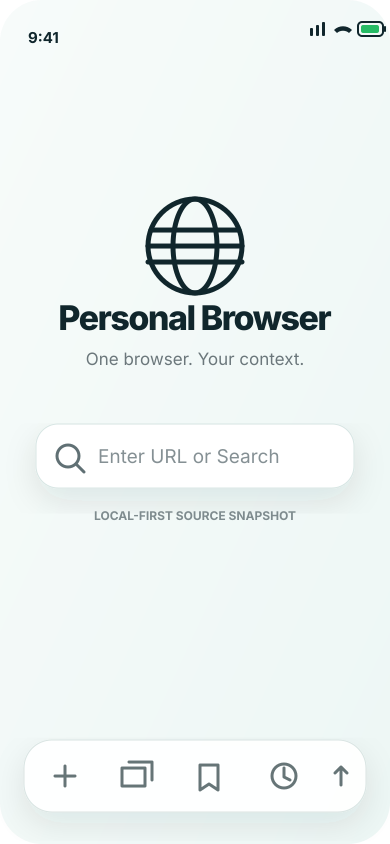
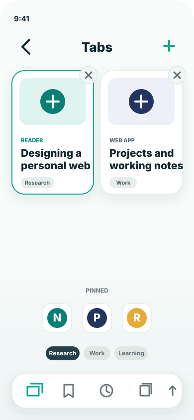
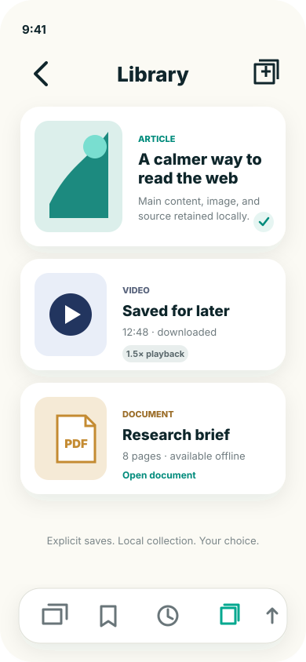

# Personal Browser

Personal Browser is an independent, local-first iPhone browser source snapshot periodically derived from the commercial [Browser by Prifina](https://browser.prifina.com/). It may not match the current commercial product. Snapshot `2026-10.1` is a separate application with its own bundle identifier, storage, artwork, and unsigned build defaults.

## Choose the right edition

- **Try the maintained end-user app:** [Browser product site](https://browser.prifina.com/) · [Join the Browser beta in TestFlight](https://testflight.apple.com/join/VZZPdDXA)
- **Build or fork Personal Browser:** use this repository as an MIT-licensed starting point for your own browser.

The commercial app is the best way to test the continuously maintained product experience. This repository is a periodic source snapshot for builders; feature parity, migrations, and release continuity are not promised.

## Start a coding agent

Give an agent this short prompt:

```text
Work on this Personal Browser repository. Read AGENTS.md and
docs/AGENT_START_PROMPT.md before acting. Preserve the local-first privacy,
Incognito, session-isolation, unsigned-build, and publication boundaries.
Inspect git status, make a concrete plan for multi-file work, implement the
smallest coherent change, run proportional tests plus the source boundary
scanner, and report exactly what changed and what was not verified. Do not
publish, distribute, activate managed Apple capabilities, or add hosted data
flows without explicit maintainer authorization.
```

The repository-level rules are in [`AGENTS.md`](AGENTS.md). For a fuller copy-ready prompt, verification commands, and a future-snapshot prompt, use the [agent startup guide](docs/AGENT_START_PROMPT.md).

## What it includes

- [SwiftUI](https://developer.apple.com/xcode/swiftui/) and [WebKit](https://developer.apple.com/documentation/webkit) browsing with tabs, pinned tabs, Subtabs, bookmarks, history, and downloads.
- Separate persistent website sessions, optional owner-created Roles, and nonpersistent Incognito browsing.
- Reader, Library, Reader PDF export, document/media viewing, and explicit transcription actions.
- Local Browsing Insights and opt-in, reversible site settings.
- No required account, hosted backend, PIOS Core, PIOS connection, or AI service. These ecosystem terms are explained below; none is active in this snapshot.

See [features and limitations](docs/FEATURES_AND_LIMITATIONS.md) for the exact snapshot boundary.

## Illustrative screens

These privacy-safe illustrations show the interaction model of this source snapshot. They are not App Store screenshots and may differ from a locally built version.

<p align="center">
  
  
  
</p>

## Principles

- Browsing works without an account or hosted service: it does not require [Core by Prifina](https://core.prifina.com/), a [self-hosted Core](https://github.com/peecos/pios-core-self-hosted), or another [PIOS](https://github.com/peecos/pios)-compatible system.
- Website sessions use separate WebKit stores; Incognito uses nonpersistent storage and is excluded from normal history and restoration.
- Saved items, Reader captures, downloads, and Insights are local unless the user explicitly exports or shares them.
- [Apple managed capabilities](https://developer.apple.com/help/account/reference/supported-capabilities-ios) are absent in the default source build.
- Personal information is not collected for the source publisher by default.

## Build

Requires macOS with [Xcode](https://developer.apple.com/xcode/) 26.3 or later and [XcodeGen](https://github.com/yonaskolb/XcodeGen), an open-source tool that generates an Xcode project from `project.yml`. Snapshot `2026-10.1` was verified with Xcode 26.6. The source target is iOS 17 or later.

```sh
xcodegen generate
xcodebuild -project PersonalBrowser.xcodeproj -scheme PersonalBrowser \
  -destination 'generic/platform=iOS' CODE_SIGNING_ALLOWED=NO build-for-testing
python3 scripts/verify_public_snapshot.py
```

For device signing and test steps, see [build and signing](docs/BUILD_AND_SIGNING.md). The example source bundle ID is `org.libertyequalitydata.personalbrowser`; change it for your distribution. Apple managed entitlements, including Default Browser, do not transfer with source code.

## Ecosystem and technology references

- **[Liberty. Equality. Data.](https://libertyequalitydata.org/)**—sometimes shortened to **LED**—promotes and expands a person-centric Personal App Ecosystem using the hierarchy **Core → PIOS → Personal Ecosystem**. Participating applications can be commercial, proprietary, open source or community-maintained; what matters is that the person remains central and authorized applications can work with a common personal-information Core rather than trapping context in separate app silos. Personal intelligence is the outcome of that holistic system. LED's [GitHub organization](https://github.com/libertyequalitydata) publishes Personal Browser and related open work.
- **[Prifina](https://www.prifina.com/)** develops the continuously maintained commercial Browser app. The commercial app is useful for end-user testing; this repository remains a separately maintained source snapshot.
- **[PIOS](https://github.com/peecos/pios)** means Personal Information Operating System: the open reference framework for a holistic, owner-controlled personal information system from which personal intelligence can emerge. It is future compatibility context only; this snapshot has no live PIOS connection.
- **Core** is the foundation and center of PIOS, providing its owner-controlled information, permissions, continuity and compatibility layer. PIOS is the wider operating system built around Core, and the Personal Ecosystem is the application and service environment enabled by PIOS. Core can be [self-hosted](https://github.com/peecos/pios-core-self-hosted), deployed by the owner in [AWS](https://github.com/peecos/pios-core-aws-template), or used through a compatible hosted service such as **[Core by Prifina](https://core.prifina.com/)**. No Core option is required or connected in this snapshot.
- **[SwiftUI](https://developer.apple.com/xcode/swiftui/)** is Apple's user-interface framework. **[WebKit](https://developer.apple.com/documentation/webkit)** is Apple's web-content engine and provides `WKWebView`, which renders webpages in the app.
- **[Xcode](https://developer.apple.com/xcode/)** is Apple's development environment. **[XcodeGen](https://github.com/yonaskolb/XcodeGen)** creates the generated Xcode project from the repository's reviewed `project.yml` specification.
- **[TestFlight](https://developer.apple.com/testflight/)** is Apple's beta-distribution service. The linked TestFlight build belongs to the commercial app, not to this source repository.
- **[MIT License](https://opensource.org/license/mit)** is the permissive open-source license used here. The repository's controlling license text is the local [LICENSE](LICENSE) file.

## Documentation

- [Features and current limitations](docs/FEATURES_AND_LIMITATIONS.md)
- [Architecture and data boundaries](docs/ARCHITECTURE.md)
- [Maintainer guide](docs/MAINTAINER_GUIDE.md)
- [Build, signing, and physical-device verification](docs/BUILD_AND_SIGNING.md)
- [Default Browser entitlement boundary](docs/DEFAULT_BROWSER_ENTITLEMENT.md)
- [Agent startup prompt](docs/AGENT_START_PROMPT.md)
- [Privacy](PRIVACY.md), [security](SECURITY.md), and [contributing](CONTRIBUTING.md)

The in-app **About** page repeats the source-build capability boundary and links to the continuously maintained commercial Browser website and beta, so people testing a local build can distinguish the two editions without consulting the repository first.

## Snapshot and license

The [MIT License](LICENSE) permits personal, open-source, and commercial derivatives. Future snapshots may be unrelated code drops with no shared ancestry, API, data migration, or compatibility continuity. There is no publication cadence or promise to release every commercial change. See [snapshot model](SNAPSHOT_MODEL.md) and [snapshot metadata](SNAPSHOT.json).

The source is provided without warranty, hosted service, support SLA, or release cadence. Derivatives must not imply endorsement by Prifina, Liberty. Equality. Data., Apple, or supported websites. Product names and commercial identity are not licensed by the MIT source grant.
